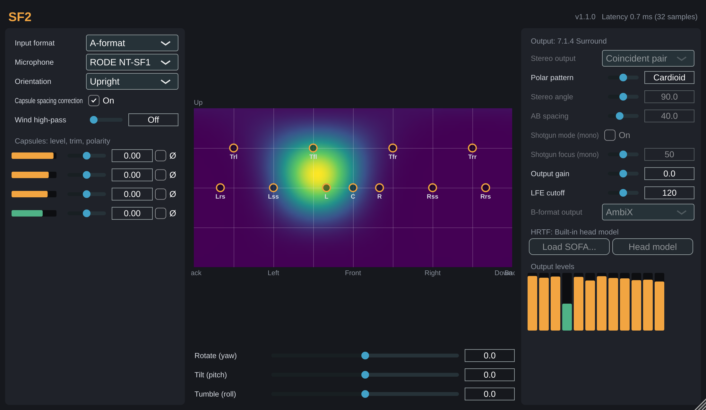

# SF2

An ambisonic plugin for tetrahedral (A-format) and B-format microphones: a free replacement for SoundField by RØDE.
See [docs/DESIGN.md](docs/DESIGN.md) for the research and design.



## Download

Ready-to-use macOS builds (VST3, AU, standalone app; Windows and Linux are paused for now) are on the
[Releases page](https://github.com/jstg-235/SF2/releases). Unzip and follow `INSTALL.txt`. Builds are not code-signed yet.

## Status

v1.1, the "quality" release.

Input
- A-format input for RØDE NT-SF1, SoundField SPS200, Sennheiser AMBEO VR, Core Sound TetraMic and Zoom H3-VR, or B-format in FuMa or AmbiX
- Capsule spacing correction (on by default): frequency-dependent A-to-B per mic model, designed by least squares against the ideal response, fading to diffuse-field gain above the array's aliasing frequency, capped at +6 dB. Adds 32 samples (0.7 ms) at 48 kHz. The capsule radii are estimates until we measure real units
- Per-capsule trim (±6 dB) and polarity, and a 4th-order wind high-pass (off, 10 to 200 Hz)
- Mic orientation (upright, inverted, end-fire) and scene rotate, tilt and tumble

Output
- Virtual mics from omni to figure-8 for mono, stereo and any surround or immersive host layout up to 16 channels (5.1, 7.1, 5.1.2, 7.1.4, ...), with LFE low-pass
- Stereo output types: coincident pair, spaced AB (5 to 100 cm), ORTF, NOS and DIN. Spaced pairs are parametric: per frequency bin the direction of arrival sets each mic's real time of arrival, so a source gets its true time difference. Adds 1024 samples (21 ms) at 48 kHz
- Binaural (headphones): a built-in spherical head model, or any measured HRTF set loaded from a SOFA file (diffuse-field equalised, any sample rate). Adds 48 samples (1 ms) at 48 kHz. Head tracking works by automating yaw, pitch and roll
- Shotgun mode on mono output (on/off, with a focus control). Adds 1024 samples at 48 kHz when on
- First-order B-format output in AmbiX or FuMa
- Latency is always reported to the host, which compensates it

Window
- Live sound-field heat map (colour-blind-safe palette) with markers where the outputs point. Drag the map to rotate the scene; double-click a spot to bring it to the front
- Capsule and output level meters, latency readout

Formats: VST3 and Standalone on all platforms, AU on macOS. AAX later.

## Layout

| Path | What |
| --- | --- |
| `dsp/` | Host-independent DSP library (`sf2dsp`), plain C++20, no JUCE |
| `sofa/` | SOFA HRTF loader (`sf2sofa`), builds libmysofa and zlib |
| `packaging/` | Install notes shipped in the release zips |
| `tests/` | GoogleTest unit tests for the DSP |
| `plugin/` | JUCE 9 plugin: parameters, bus layouts, state, editor |
| `docs/DESIGN.md` | Research and design |

## Building

Requires CMake 3.22+ and a C++20 compiler. JUCE 9.0.5, GoogleTest, libmysofa 1.3.5 and zlib 1.3.1 are fetched automatically.

```sh
cmake -S . -B build -DCMAKE_BUILD_TYPE=Release
cmake --build build --config Release --parallel
ctest --test-dir build -C Release
```

Options: `-DSF2_BUILD_PLUGIN=OFF` builds only the DSP library and tests; `-DSF2_WITH_SOFA=OFF` leaves out SOFA loading; `-DSF2_JUCE_PATH=/path/to/JUCE` uses a local JUCE checkout.

Every push to `main` builds, tests and validates on macOS and publishes the zip as the GitHub release for the version in `CMakeLists.txt`.

On Linux, install JUCE's dependencies first:

```sh
sudo apt-get install libasound2-dev libfreetype-dev libfontconfig1-dev libx11-dev libxcomposite-dev \
  libxcursor-dev libxext-dev libxi-dev libxinerama-dev libxrandr-dev libxrender-dev libglu1-mesa-dev
```

Plugins are written to `build/plugin/SF2_artefacts/Release/`.

## Conventions

AmbiX (ACN channel order, SN3D) internally. +x front, +y left, +z up; azimuth is positive to the left.
Positive yaw moves a front source to the left, positive pitch moves it up, positive roll moves a left source up.
